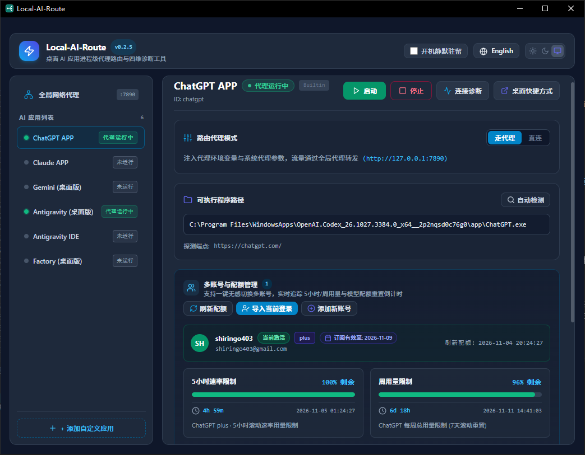
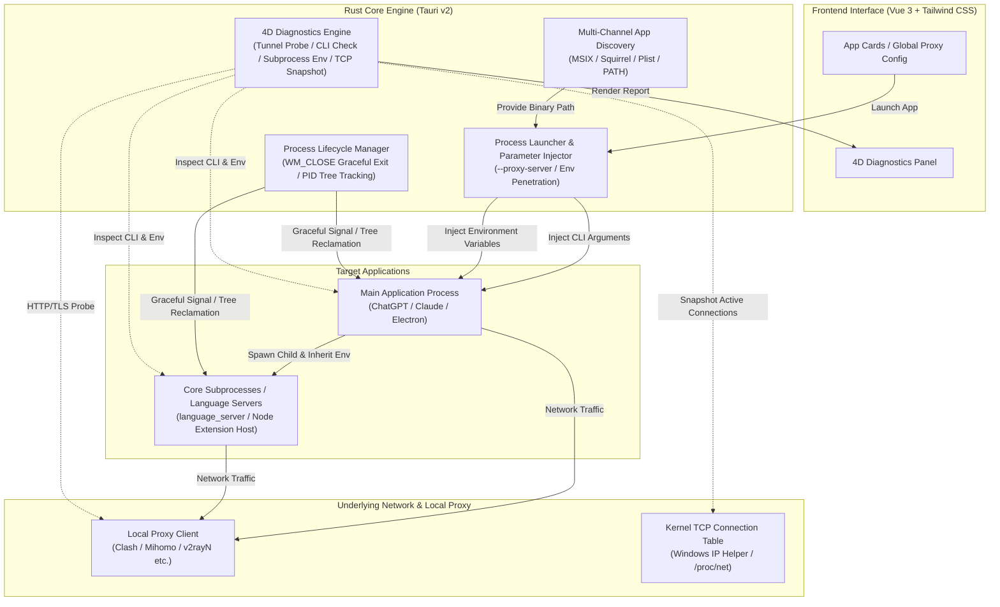

<h1 align="center">Local-AI-Route</h1>

<p align="center">
  <a href="README.md">简体中文</a> · <b>English</b>
</p>

<p align="center">
  
  
  
  
  
  
  
  
</p>

**Local-AI-Route** is a lightweight, zero-global-TUN, process-scoped proxy launcher and four-dimensional connection diagnostics tool designed for desktop AI applications. It natively supports:

- 🤖 **ChatGPT** (compatible with Windows Store/standalone, macOS App Bundles, and Linux desktop clients)
- 🧠 **Claude** (compatible with Windows MSIX/Squirrel, macOS App Bundles, and Linux desktop clients)
- ✨ **Gemini Desktop** (compatible with Windows Squirrel, macOS App Bundles, and Linux desktop clients)
- 🌌 **Antigravity Desktop**
- ⚡ **Antigravity IDE** (strict app disambiguation & dedicated LSP proxy inheritance checks)
- 🧩 **Custom Extensible**: One-click addition of any Chromium / Electron-based desktop AI app (e.g. Cursor, Windsurf)

> [!NOTE]
> - This tool does not provide any proxy servers or network services. It merely injects your running local proxy (e.g. Clash / Mihomo / FlClash / v2rayN) into compatible desktop AI applications via process arguments and environment variables.
> - **Cross-Platform Support**: Natively adapted for Windows, macOS (Apple Silicon & Intel), and major Linux distributions with process-level proxy injection, signal management, 4D connection diagnostics, and desktop shortcut generation.

<p align="center">
  
</p>

---

## Key Features

- 🎯 **Zero-Global-TUN / No System Proxy Tampering**: Pure process-level network isolation. Routes only designated AI apps through the proxy, leaving internal VPNs, LAN resources, and regular software untouched.
- 🤖 **Deep Native Adaptation**: Out-of-the-box support for ChatGPT, Claude, Gemini Desktop, Antigravity Desktop, and Antigravity IDE, with one-click custom addition for any Chromium / Electron apps (e.g. Cursor, Windsurf).
- 🎛️ **Concurrent Management & Independent Toggling**: Master-Detail split layout completely eliminates vertical page scrolling, featuring quick-action hover controls, per-app "Proxied / Direct" switches, isolated global proxy settings, and local port scanning.
- 🔄 **Smart State Sensing & Safe Restart**: Real-time detection of running state, direct conflicts, and proxy port drift; sends graceful close signals first to safeguard workspace data.
- 🩺 **Four-Dimensional Diagnostics Engine**: Comprehensive diagnostics spanning upstream tunnel reachability, main CLI arguments, LSP child process env inheritance, and kernel-level TCP snapshots with one-click privacy redaction.
- 🚀 **Desktop Shortcuts & Lightweight Tray**: Generate standalone desktop shortcuts with original icons, minimize to tray on close, and idle in the background with only ~20MB RAM usage.
- 📦 **Portable & Modern Bilingual UI**: Auto-detects portable `data/` directory and standard installation modes, with instant English / Simplified Chinese switching and Dark / Light theme support.

---

## Why Not TUN Mode or System Proxy? (Comparison & Advantages)

Many developers wonder: *"Since proxy clients like Clash, Mihomo, and v2rayN already provide 'System Proxy' and 'TUN Virtual Interface Mode', why do we need Local-AI-Route?"*

In real-world development and enterprise office environments, TUN mode is not a silver bullet, and system proxies have severe blind spots regarding subprocess propagation. Below is an in-depth architectural and practical comparison:

| Evaluation Dimension | System Proxy | TUN Mode (Virtual NIC) | Local-AI-Route (Process-Level Injection) |
| :--- | :--- | :--- | :--- |
| **Interception Layer** | Application layer (System Registry/WinINet) | Network layer (L3 IP routing table interception) | **Process-level application layer injection (CLI + Env)** |
| **Corporate VPN Compatibility** | Often overwritten or broken by enterprise VPNs | ❌ **Severe Conflicts** (Routing collisions, drops internal repos/OA, security flags) | ✅ **Flawless Coexistence (Zero Conflict)**, leaves system routing table untouched |
| **Privileges & Driver Footprint** | No driver needed, standard user rights | ⚠️ **Requires Administrator (UAC)** & Wintun kernel drivers | ✅ **Pure User-Space Execution**, zero kernel drivers, zero privilege escalation |
| **System Intrusiveness & Stability** | Improper client exit causes total network outages | Driver crashes or leaks risk Winsock corruption or routing blackholes | ✅ **Zero Intrusiveness**, never alters system network configurations |
| **Subprocess / LSP Inheritance** | ❌ **Poor** (Node/LSP extensions frequently ignore system proxy) | ✅ Good (handled comprehensively at L3) | ✅ **Deep Penetration** (injects `HTTP_PROXY` & `NODE_USE_ENV_PROXY`) |
| **UDP Bypasses & QUIC Leaks** | Cannot intercept UDP traffic | Relies on firewall / route rule matching | ✅ **Forced `--disable-quic` injection**, cutting off UDP bypass risks |
| **Rule Maintenance & Mental Overhead** | Very limited; basic bypass lists or PAC scripts only | ❌ **High Mental Overhead**: Requires writing or subscribing to extensive rule sets (GeoSite, Process-Name, CIDR); frequent AI endpoint updates require constant tracking, risking silent leaks and bans if rules lag behind | ✅ **Zero Rule Maintenance (Zero Config Rules)**: Traffic is bound to the proxy at the network stack level; 100% physically deterministic with no need to worry about newly added domains or CDNs |
| **Rule Drift & Accidental Leaks** | Missed rules fall back to direct | ⚠️ **High Risk**: AI endpoints change rapidly; leaked traffic connects directly, triggering bans | ✅ **Physical Determinism**: All target traffic is strictly bound to the configured proxy port |
| **Observability & Diagnostics** | Blackbox, hard to diagnose failures | Blackbox, requires Wireshark packet capture | ✅ **Native 4D Diagnostics**: Real-time kernel TCP snapshot verification with redacted export |
| **Impact on Daily Applications** | Domestic apps risk hijacked traffic or geo-bans | All traffic routes through proxy core; LAN/printers may break | ✅ **Surgically isolated to target AI apps**; Slack, WeChat, games, and LAN stay direct |

> [!TIP]
> **When should you choose Local-AI-Route?**
> 1. **Your work machine must stay connected to a corporate VPN** (e.g. GlobalProtect, Cisco AnyConnect, EasyConnect), where enabling TUN breaks intranet services or corporate routing;
> 2. **You are tired of maintaining complex routing rules and updating geo-databases**, seeking a foolproof "launch and 100% of this app's traffic routes through proxy" experience;
> 3. **You want local communication, games, and LAN NAS traffic untouched**, isolating proxy tunnels strictly to ChatGPT, Claude, Cursor, and other AI tools;
> 4. **You prefer not to install kernel drivers or deal with UAC administrator prompts**, wanting a clean, portable utility;
> 5. **Your AI client frequently spins or shows a blank screen**, and you need kernel-level TCP socket snapshots and tunnel probes to differentiate between network blockage and Cloudflare WAF challenges.

---

## Technical Architecture & Implementation

Local-AI-Route is built with **Tauri v2 + Rust** to deliver high-performance, low-overhead native execution without requiring virtual network interfaces (TUN/TAP). It achieves lightweight, secure, and pinpoint proxy routing via **process-level argument injection**, **environment variable penetration**, and **kernel-level network socket inspection**.



### 1. Process-Level Network Isolation & Parameter Injection

Traditional global proxies or TUN virtual adapters intercept all host traffic indiscriminately, frequently causing corporate VPN conflicts, intranet routing breaks, unintended data meter billing, and UDP blocking. Local-AI-Route isolates traffic cleanly at the operating system level:

- **Chromium / Electron Network Stack Injection**:
  Command-line arguments (`--proxy-server=<protocol>://<ip>:<port>` and `--proxy-bypass-list=<rules>`) are injected directly into the target process during launch. Chromium's embedded network service (Blink/V8) routes all HTTP/HTTPS and WebSocket requests through the specified local proxy port.
- **Forced QUIC Disabling (`--disable-quic`)**:
  Desktop AI apps (such as ChatGPT and Claude) rely heavily on HTTP/2 streams and Server-Sent Events (SSE). Some local proxy clients suffer from packet loss or silent timeouts when handling QUIC (UDP-based HTTP/3) handshakes. Injecting `--disable-quic` forces the network stack to fall back to proven, robust TCP tunnels, eliminating indefinite loading spinners and blank screens.
- **Multi-Tier Environment Variable Penetration**:
  In AI developer environments like Antigravity or Cursor, model completions and LSP services run inside decoupled subprocesses (e.g., `language_server` written in Go, Node.js, or Python) rather than the Chromium web stack. The injector populates `HTTP_PROXY`, `HTTPS_PROXY`, `ALL_PROXY`, and `NO_PROXY` (both upper and lowercase), together with `NODE_USE_ENV_PROXY=1`, ensuring all descendant worker threads and sidecars inherit proxy configurations seamlessly.

### 2. Cross-Platform Multi-Channel Discovery & Disambiguation

To eliminate the need for users to manually hunt down executable paths, the engine provides automatic multi-channel discovery:

- **Windows Registry Deep Scanning & Self-Healing**:
  - **MSIX / Windows Store Penetration**: For ChatGPT (`OpenAI.ChatGPT`, `OpenAI.Codex`) and Claude installed via the Microsoft Store, default shortcuts point to Execution Aliases (`WindowsApps` reparse points), which fail to accept runtime proxy arguments or lose icons. The engine traverses `AppModel\Repository\Packages` in the registry to pinpoint the actual binary residing in the physical `WindowsApps` volume.
  - **Squirrel Dynamic Version Self-Healing**: Applications using Squirrel installers (like Claude Win32) place binaries inside version-named subdirectories (e.g. `%LOCALAPPDATA%\AnthropicClaude\app-0.x.x\Claude.exe`). The engine parses version increments dynamically, automatically retargeting the newest release after background auto-updates.
  - **Strict Disambiguation**: Antigravity Desktop and Antigravity IDE (a specialized VS Code fork) share similar naming conventions. The engine performs strict signature and registry key disambiguation to prevent mismatched launches.
- **macOS App Bundle Recursive Parsing**:
  Scans `/Applications` and `~/Applications`, reading `CFBundleExecutable` from `.app/Contents/Info.plist`; integrates with Spotlight (`mdfind`) for sub-second app location.
- **Linux XDG Specification & PATH Traversal**:
  Parses `.desktop` entries across `/usr/share/applications`, `~/.local/share/applications`, and Flatpak/Snap directories, combined with sequential system `PATH` and FHS directory checks.

### 3. Staged Safe Shutdown & Process Tree Topology Reclamation

Switching proxy ports or toggling between "Proxied" and "Direct" modes requires a full process restart to apply new parameters. To prevent data corruption or orphaned instances, the engine employs a staged lifecycle controller:

- **Graceful Close Priority**:
  - On Windows, the engine iterates root and visible windows via Win32 `EnumWindows` and posts `WM_CLOSE` messages; on Unix platforms, it dispatches `SIGTERM`.
  - This allows applications to execute built-in lifecycle hooks (saving unsaved files, disconnecting active sessions, persisting drafts).
- **Process Tree Topology Tracking (PID Tree DAG)**:
  Modern Electron apps spawn extensive process trees (Renderer, GPU, Utility, Crashpad, Extension Hosts). Many minimize to the system tray on window close.
  The engine tracks the complete process DAG. If helper processes remain active or the user confirms a force restart, the entire process subtree is cleanly dismantled, preventing port conflicts and dual-instance deadlocks.
- **Four-State Runtime Machine**:
  Continuously inspects active system process tables and evaluates command-line arguments against configured proxies, classifying states into:
  `Stopped`, `RunningDirect`, `RunningProxied`, and `RestartNeeded`.

### 4. Four-Dimensional Diagnostics Engine

When connection issues occur, conventional tools report vague "connection failed" errors. Local-AI-Route's 4D engine pinpoints the root cause:

1. **Dimension 1: Upstream Tunnel Probe**:
   Dispatches a lightweight HTTP/TLS handshake through the configured proxy to target services (`chatgpt.com` or Google probes). **Crucial capability**: Differentiates between "proxy unreachable / upstream timeout" and "HTTP 403 Forbidden". An HTTP 403 proves that the local-to-remote TCP/TLS tunnel is fully established and functional, isolating the issue to WAF credentials rather than network routing.
2. **Dimension 2: Main Process CLI Args Check**:
   Fetches active process command lines in real time to verify that `--proxy-server` and `--disable-quic` flags are active and match the currently configured port.
3. **Dimension 3: LSP Subprocess Env Verification**:
   Inspects the memory environment space of critical language servers and sidecars (e.g. Antigravity's `language_server`) to guarantee that `HTTPS_PROXY` is successfully inherited.
4. **Dimension 4: Kernel-Level Active TCP Snapshot**:
   - Queries the system connection table (via Win32 `GetExtendedTcpTable` / `MIB_TCPTABLE_OWNER_PID` on Windows, and socket metrics on Unix).
   - Filters all connections owned by the application's process tree, highlighting active `ESTABLISHED` sockets directed to the local proxy port (e.g. `:7890`), providing definitive physical proof of routed traffic.
- **Privacy Redaction**:
  All exported diagnostic reports automatically regex-redact local user home directories (masking them as `%USERPROFILE%`), ensuring safety when sharing diagnostic logs publicly.

---

## Quick Start

### Option 1: Download from Releases (Ready-to-Use)

Grab the appropriate package for your system from [GitHub Releases](../../releases):
- 💻 **Windows**: Download and extract the portable ZIP `Local-AI-Route-<version>-windows-x64-portable.zip` or install via `Local-AI-Route_<version>_x64-setup.exe`.
- 🍎 **macOS**: Download `Local-AI-Route_<version>_universal.dmg` (Universal binary with native Apple Silicon M-series & Intel support) and drag to Applications.
- 🐧 **Linux**: Download the `.deb` package (`sudo dpkg -i ...`) or standalone `.AppImage` (`chmod +x` and run directly).

Usage:
1. Ensure your local proxy client (Clash, Mihomo, FlClash, v2rayN, etc.) is active.
2. Launch `Local-AI-Route` and click **"Scan Local Ports"** to detect your local proxy port (or configure manually and click **"Save Config"**).
3. Click **"Launch"** on the desired application card (or generate a **"Desktop Shortcut"** to start the app with proxy directly from your desktop).

### Option 2: Build from Source (Rust & Node.js)

#### Prerequisites
- **Rust Toolchain**: `stable`
- **Node.js**: v18+ & **pnpm**: v9+
- **Linux Build Dependencies (Ubuntu/Debian)**:
  ```bash
  sudo apt-get install -y libwebkit2gtk-4.1-dev libayatana-appindicator3-dev librsvg2-dev patchelf libxdo-dev libfuse2
  ```

#### Commands
```bash
# 1. Install frontend dependencies
pnpm install

# 2. Start dev mode (Hot-reload UI + Rust backend)
pnpm tauri dev

# 3. Build production package
# Windows: build standalone portable release package
.\scripts\build_windows.ps1

# macOS / Linux: build native packages (.dmg / .app / .deb / .AppImage)
pnpm tauri build
```

---

## Acknowledgements & License

- **Upstream Inspiration**: Architectural concepts and multi-channel discovery mechanisms are inspired by [oliver804/Local-Route-Launcher](https://github.com/oliver804/Local-Route-Launcher), [DSDS-CMHL/EasyAntigravity](https://github.com/DSDS-CMHL/EasyAntigravity), and [king-sheol/claude-desktop-windows-proxy-launcher](https://github.com/king-sheol/claude-desktop-windows-proxy-launcher). See [THIRD_PARTY_NOTICES.md](THIRD_PARTY_NOTICES.md) for details.
- **Local Zero-Telemetry**: No tracking, no data collection.
- **License**: [MIT License](LICENSE)
