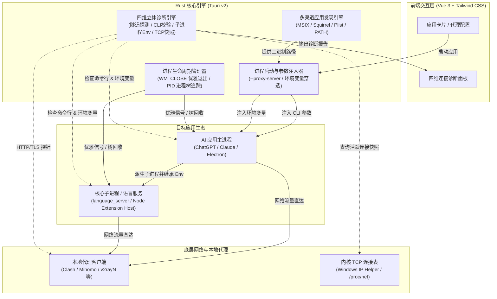

<h1 align="center">Local-AI-Route</h1>

<p align="center">
  <b>简体中文</b> · <a href="README.en.md">English</a>
</p>

<p align="center">
  
  
  
  
  
  
  
  
</p>

**Local-AI-Route** 是一款专为桌面 AI 应用打造的轻量级、免全局 TUN、免改系统代理的**进程级本地代理启动与管理工具**。开箱**原生深度适配**：

- 🤖 **ChatGPT**（兼容 Windows 商店/独立安装包、macOS App Bundle、Linux 桌面客户端）
- 🧠 **Claude**（兼容 Windows MSIX/Squirrel、macOS App Bundle、Linux 桌面端）
- ✨ **Gemini 桌面版**（兼容 Windows Squirrel、macOS App Bundle、Linux 桌面端）
- 🌌 **Antigravity 桌面版**
- ⚡ **Antigravity IDE**（精确区分注册表与应用标识，专项保障 LSP 子进程代理继承）
- 🧩 **自定义扩展**：一键添加任意 Chromium / Electron 类桌面 AI 应用（如 Cursor、Windsurf 等）

> [!NOTE]
> - 本工具不提供任何代理节点或网络接入服务，仅将您本机已运行的本地代理（如 Clash / Mihomo / FlClash / v2rayN）按进程级参数与环境变量注入兼容的桌面 AI 应用。
> - **跨平台支持**：深度适配 Windows、macOS (Apple Silicon & Intel) 以及主流 Linux 发行版，提供原生的进程级代理注入、信号管理、四维连接诊断与桌面快捷方式生成。

<p align="center">
  
</p>

---

## 核心特性

- 🎯 **免全局 TUN / 免改系统代理**：纯进程级网络接管，只让指定 AI 应用走代理，内网 VPN、局域网访问与日常应用完全不受干扰。
- 🤖 **深度适配主流桌面 AI 应用**：开箱支持 ChatGPT、Claude、Gemini 桌面版、Antigravity 桌面版与 Antigravity IDE，并支持一键添加任意 Chromium / Electron 应用（如 Cursor、Windsurf）。
- 🎛️ **多应用并发与独立分流**：Master-Detail 左右分栏紧凑布局，彻底消除长滚动条；支持悬浮快捷启停与各应用独立「走代理 / 直连」分流；全局代理独立收口，支持端口一键扫描与 `NO_PROXY` 规则。
- 🔄 **智能状态感知与安全重启**：实时感知运行状态、直连冲突与代理端口变更；优先发送窗口平滑退出信号，保障工作区内容安全。
- 🩺 **四维立体连接诊断**：包含代理隧道可达性、命令行启动参数、LSP 子进程环境继承及内核级 TCP 连接快照，支持一键隐私脱敏导出。
- 🚀 **极轻驻留与桌面快捷启动**：支持生成带原应用图标的桌面快捷方式，支持关闭至托盘与开机静默驻留，日常内存占用仅约 20MB。
- 📦 **绿色便携与现代双语交互**：自动识别 `data/` 目录便携模式，支持中英双语即时切换与浅色/深色主题。

---

## 为什么不用 TUN 模式或系统代理？（方案横向对比）

许多开发者会问：“既然 Clash / Mihomo / v2rayN 等代理客户端已经提供了「系统代理（System Proxy）」和「TUN 虚拟网卡模式」，为什么还需要 Local-AI-Route？”

在真实的办公与开发场景中，TUN 模式并非万灵药，系统代理亦存在严重的“子进程断流”短板。以下是三种方案的深度技术与场景对比：

| 评估维度 | 传统系统代理 (System Proxy) | TUN 虚拟网卡模式 (TUN Mode) | Local-AI-Route (进程级精准路由) |
| :--- | :--- | :--- | :--- |
| **接管层级** | 应用层（修改系统注册表/WinINet） | 网络层（L3 IP 层虚拟网卡劫持路由） | **进程级应用层精准注入（CLI + Env）** |
| **企业 VPN 兼容性** | 易被企业客户端重置覆盖或死锁 | ❌ **严重冲突**（路由抢占、公司内网/代码库/OA断联、安全告警） | ✅ **完美共存（0 冲突）**，不触碰系统路由表 |
| **权限与驱动依赖** | 无需驱动，普通权限 | ⚠️ **需管理员特权（UAC）**，依赖 Wintun 驱动 | ✅ **纯用户态运行，免安装驱动，零提权** |
| **系统侵入与稳定性** | 客户端异常退出易导致全机断网 | 驱动崩溃或配置异常易致 Winsock 损坏或路由黑洞 | ✅ **绝对零侵入**，不改变任何系统配置与网络设置 |
| **子进程 / LSP 继承** | ❌ **极差**（Node/LSP 扩展大多不读取系统代理） | ✅ 较好（由 L3 网络层统揽） | ✅ **深度穿透**（注入 `HTTP_PROXY` 与 `NODE_USE_ENV_PROXY`） |
| **UDP 旁路与 QUIC 泄露** | 无法拦截 UDP 流量 | 依赖规则拦截 UDP | ✅ **强制注入 `--disable-quic`**，切断 UDP 绕过风险 |
| **规则维护与心智负担** | 规则能力弱，仅支持简单 bypass 规则或 PAC 脚本 | ❌ **心智负担极重**：必须手动编写或订阅第三方规则库（如 `GeoSite`、`PROCESS-NAME`、`IP-CIDR`），AI 平台域名与 CDN 频变，规则一旦滞后出现漏网走直连易遭封号，需频繁更新追踪 | ✅ **零规则维护（Zero Config Rules）**：直接在网络栈层面将目标进程流量 100% 物理绑定到本地代理，无需关心厂商新增了什么域名或 CDN |
| **分流失误风险** | 规则未命中则走直连 | ⚠️ **规则滞后风险**：AI 域名频变，漏网流量走直连易被封号 | ✅ **物理确定性**：目标应用所有网络请求强制绑定代理端口 |
| **流量与状态透明度** | 黑盒，难以定位断流原因 | 黑盒，排查需 Wireshark 抓包 | ✅ **独家四维诊断**：内核 TCP 快照直接核验证据，支持脱敏导出 |
| **日常应用影响** | 国内软件可能被劫持或异地风控 | 整机流量过核心，局域网/打印机易受干扰 | ✅ **仅目标 AI 应用走代理**，微信/钉钉/局域网完全不受影响 |

> [!TIP]
> **什么时候该用 Local-AI-Route？**
> 1. **办公机需要常驻企业内网 VPN**（如 GlobalProtect, Cisco AnyConnect, EasyConnect），开启 TUN 导致内网断线或路由崩溃；
> 2. **厌倦了繁琐的分流规则配置与频繁更新规则库**，只想要“只要启动这个软件，它的所有流量就 100% 物理确定性走代理”的省心体验；
> 3. **不想让国内聊天、游戏、局域网 NAS 流量经过代理内核**，只希望 ChatGPT、Claude、Cursor 等特定 AI 工具走代理；
> 4. **反感安装虚拟网卡驱动与每次弹窗 UAC 提权**，追求绿色轻量、随开随关；
> 5. **AI 客户端频繁报错或白屏**，需要通过内核级 TCP 快照和隧道探测排查究竟是网络阻断还是被 WAF 拦截。

---

## 技术原理与架构实现

Local-AI-Route 采用 **Tauri v2 + Rust** 构建高性能底层核心，无需安装任何虚拟网卡驱动（TUN/TAP），通过**进程级参数注入**、**环境变量穿透**与**内核网络表核验**实现轻量、安全、精准的网络路由。



### 1. 进程级网络隔离与参数注入

传统全局代理或 TUN 虚拟网卡模式往往会强制拦截整机所有流量，容易导致内网穿透中断、企业 VPN 路由冲突、非目标流量被计费以及 UDP 协议阻断等问题。Local-AI-Route 在启动目标应用时从操作系统底层进行精确隔离与注入：

- **Chromium / Electron 网络栈注入**：
  通过命令行直接向目标主进程注入 `--proxy-server=<protocol>://<ip>:<port>` 与 `--proxy-bypass-list=<rules>` 参数，使 Chromium 的内置网络栈（Blink/V8 网络服务）在解析与发起任何网络请求时，强制通过配置的本地代理端口。
- **强制禁用 UDP QUIC（`--disable-quic`）**：
  桌面 AI 应用（如 ChatGPT、Claude）大量依赖 HTTP/2 与长连接流式推送（SSE）。部分代理工具在处理 QUIC（HTTP/3 基于 UDP）握手时可能发生静默丢包或连接超时。注入 `--disable-quic` 可强制让网络栈降级使用稳定的 TCP 隧道连接，彻底解决客户端卡在 Loading 或白屏的问题。
- **多层级环境变量穿透**：
  针对 Antigravity、Cursor 等集成开发环境与桌面助手，其代码补全模型交互、LSP（Language Server Protocol）往往运行于由主进程派生的独立子进程（如 Go/Node/Python 编写的 `language_server`），不走 Chromium 页面网络栈。为此，注入器在进程启动时全量注入 `HTTP_PROXY`、`HTTPS_PROXY`、`ALL_PROXY`、`NO_PROXY`（及其对应小写变量），并附加 `NODE_USE_ENV_PROXY=1`，确保所有派生子进程和侧车服务（Sidecar）百分百继承代理环境变量。

### 2. 跨平台多渠道二进制发现与消歧

为了让用户开箱即用、无需手动满磁盘翻找 `.exe` 或 `.app` 路径，底层实现了深度自适应的定位引擎：

- **Windows 深度注册表扫描与自愈**：
  - **MSIX / 商店版穿透**：针对从 Microsoft Store 安装的 ChatGPT（`OpenAI.ChatGPT`、`OpenAI.Codex`）与 Claude，普通快捷方式仅指向虚拟执行别名（Execution Alias），直接通过别名启动容易导致命令行参数注入丢失或图标损坏。引擎深入遍历注册表 `AppModel\Repository\Packages`，精准定位物理存储在 `WindowsApps` 目录下的真实二进制文件。
  - **Squirrel 动态版本自愈**：Claude 等采用 Squirrel 安装器的应用，其真实执行文件位于带有版本号的动态目录（如 `%LOCALAPPDATA%\AnthropicClaude\app-0.x.x\Claude.exe`）。引擎内置版本号解析与比较逻辑，当应用后台自动热升级后，能自动识别并重定向到最新版本的执行文件。
  - **精确应用消歧（Disambiguation）**：Antigravity 桌面客户端与 Antigravity IDE（基于 VS Code 分支深度定制）在注册表和安装目录中存在相近标识。引擎通过严格的包名、可执行文件签名及注册表键值比对，杜绝两者混淆。
- **macOS App Bundle 递归解析**：
  优先扫描 `/Applications` 与 `~/Applications`，解析 `.app/Contents/Info.plist` 中的 `CFBundleExecutable` 字段获取主可执行文件；支持结合系统 Spotlight（`mdfind`）实现毫秒级自动检索。
- **Linux XDG 规范与 PATH 探测**：
  遵循 XDG 桌面规范，解析 `/usr/share/applications`、`~/.local/share/applications` 以及 Flatpak / Snap 导出的 `.desktop` 文件，并依次遍历系统 `PATH` 与标准 FHS 路径。

### 3. 分级安全关闭与进程树拓扑回收

在修改代理端口或切换「走代理 / 直连」模式时，必须完全重启目标应用才能使新参数生效。为了杜绝数据损坏和进程残留，引擎设计了分级生命周期管理机制：

- **优雅退出优先（Graceful Close）**：
  - Windows 环境下通过 Win32 API（`EnumWindows`）枚举目标 PID 的根窗口与可见窗口，发送 `WM_CLOSE` 消息；Unix 环境下投递 `SIGTERM` 信号。
  - 该机制允许应用触发内置的关闭钩子（如保存未保存的文件、断开 WebSocket 会话、持久化草稿）。
- **进程树拓扑追踪（PID Tree Tracking）**：
  现代 Electron 应用拥有极其庞大的进程树（包含主进程、GPU 渲染进程、Utility 音视频进程、Crashpad 守护进程、Extension Host 等）。许多应用在收到关闭信号后会默认最小化至系统托盘继续运行。
  引擎在发出关闭请求后，周期性轮询并维护一份完整的进程有向无环图（DAG），若检测到根进程已退出但孤儿辅进程仍占用内存，或用户确认强制重启，将递归对整棵拓扑树执行深度清理，避免旧实例争抢端口或导致新参数无法挂载。
- **四态运行时状态机**：
  实时读取系统进程表中的启动命令行参数，与配置中的代理地址进行特征比对，精确划分为：
  `Stopped`（已停止）、`RunningDirect`（直连运行中）、`RunningProxied`（代理运行中）、`RestartNeeded`（检测到参数漂移，需要重启生效）。

### 4. 四维立体连接诊断引擎

当网络遇到阻碍时，传统工具往往只能告知“连接失败”，用户无法排查是本地代理未开启、参数未成功注入、还是目标网站风控。Local-AI-Route 实现了覆盖应用生命周期的四维诊断：

1. **第一维：代理隧道握手探测（Tunnel Probe）**
   经由本地配置的代理地址，使用轻量 HTTP 客户端向目标服务（如 `chatgpt.com` 或 Google 探测点）发起握手。**关键技术点**：明确区分“代理连接超时/上游不可达”与“HTTP 403 阻断”——HTTP 403 状态码说明本地代理到目标服务器的 TCP 与 TLS 隧道已经成功打通，仅因未带登录凭证被目标 WAF 拦截，由此帮助用户明确排除网络层故障。
2. **第二维：主进程启动参数校验（CLI Args Check）**
   实时抓取目标应用当前主进程的命令行（CommandLine），严格校验 `--proxy-server` 与 `--disable-quic` 是否真实加载，并核对端口是否与当前全局配置匹配。
3. **第三维：LSP 关键子进程环境变量核验（Subprocess Env Check）**
   专门针对 IDE 类应用的语言服务与插件宿主进程（如 Antigravity 的 `language_server`）。即使主进程有代理，子进程若未继承环境变量也会导致补全和 Chat 频繁断联。引擎下钻扫描子进程内存中的 `environ` 表，验证 `HTTPS_PROXY` 是否正常渗透。
4. **第四维：内核级活跃 TCP 连接快照（PID-Tree TCP Snapshot）**
   - Windows 平台通过调用底层 Win32 IP Helper API（`GetExtendedTcpTable` 读取 `MIB_TCPTABLE_OWNER_PID`），检索系统完整 IPv4 连接表；Linux/macOS 平台结合系统套接字接口。
   - 过滤出属主 PID 落在当前应用进程树范围内的所有网络连接，精准高亮标注目标端口等于本地代理端口（如 `:7890`）的 `ESTABLISHED` 连接，提供“流量确实正在走本地代理”的最直接物理证据。
- **隐私脱敏机制**：
  诊断输出包含命令行与进程快照，引擎在生成报告时自动对用户家目录路径执行正则脱敏（统一映射为 `%USERPROFILE%`），确保一键复制排障报告至论坛或反馈时，绝不泄露个人系统用户名等隐私信息。

---

## 快速开始

### 方式一：从 Release 下载（开箱即用）

从 [GitHub Releases](../../releases) 获取对应平台的发布包：
- 💻 **Windows**：下载解压免安装便携包 `Local-AI-Route-<version>-windows-x64-portable.zip` 或安装包 `Local-AI-Route_<version>_x64-setup.exe`。
- 🍎 **macOS**：下载 `Local-AI-Route_<version>_universal.dmg`（通用二进制，原生支持 Apple Silicon M 系列与 Intel 芯片），打开后拖拽至 Applications 目录。
- 🐧 **Linux**：下载 `.deb` 安装包（`sudo dpkg -i ...`）或 `.AppImage` 独立运行包（赋予执行权限 `chmod +x` 后直接运行）。

运行使用：
1. 确保本地代理客户端（Clash / Mihomo / FlClash / v2rayN 等）已启动。
2. 运行 `Local-AI-Route`，点击 **「扫描本地端口」** 快捷填入代理端口（或手动输入后点击 **「保存配置」**）。
3. 在对应卡片点击 **「启动」**（也可点击 **「桌面快捷方式」**，之后直接通过桌面图标静默带代理启动应用）。

### 方式二：从源码运行与跨平台构建（Rust + Node.js）

#### 环境准备
- **Rust Toolchain**: `stable`
- **Node.js**: v18+ & **pnpm**: v9+
- **Linux 系统依赖（Ubuntu/Debian）**：
  ```bash
  sudo apt-get install -y libwebkit2gtk-4.1-dev libayatana-appindicator3-dev librsvg2-dev patchelf libxdo-dev libfuse2
  ```

#### 构建命令
```bash
# 1. 安装前端依赖
pnpm install

# 2. 启动开发模式（热重载界面 + Rust 后端）
pnpm tauri dev

# 3. 生产发布包构建
# Windows: 构建独立绿色便携发布包
.\scripts\build_windows.ps1

# macOS / Linux: 构建原生系统安装包
pnpm tauri build
```

---

## 致谢与开源许可

- **设计参考与致谢**：本项目在架构设计与多渠道应用发现机制上参考并融合了 [oliver804/Local-Route-Launcher](https://github.com/oliver804/Local-Route-Launcher)、[DSDS-CMHL/EasyAntigravity](https://github.com/DSDS-CMHL/EasyAntigravity) 以及 [king-sheol/claude-desktop-windows-proxy-launcher](https://github.com/king-sheol/claude-desktop-windows-proxy-launcher) 的优秀思路，详见 [THIRD_PARTY_NOTICES.md](THIRD_PARTY_NOTICES.md)。
- **本地零遥测**：无任何账号体系、无后台数据上报；连接诊断仅在用户主动点击时经本地配置的代理发起无凭据握手。
- **许可证**：[MIT License](LICENSE)
