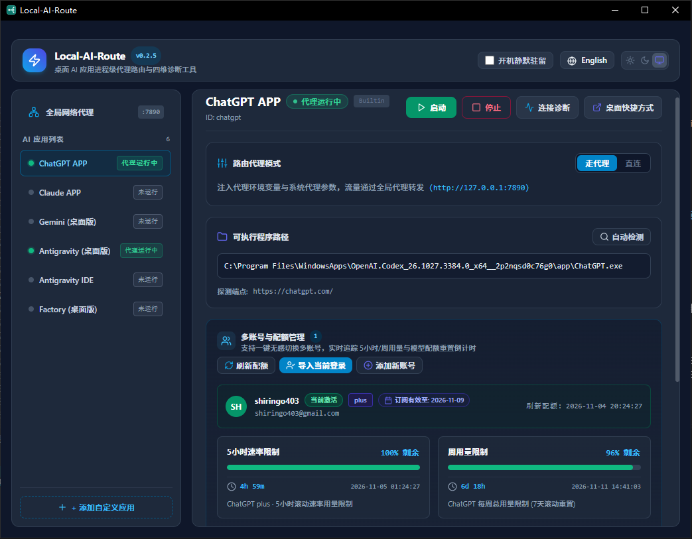

<h1 align="center">Local-AI-Route</h1>

<p align="center">
  <b>简体中文</b> · <a href="README.en.md">English</a>
</p>

<p align="center">
  
  
  
  
  
  
  
  
</p>

**Local-AI-Route** 是一款专为桌面 AI 应用打造的轻量级、免全局 TUN、免改系统代理的**进程级本地代理启动与管理工具**。开箱**原生深度适配**：

- 🤖 **ChatGPT**（兼容 Windows 商店/独立安装包、macOS App Bundle、Linux 桌面客户端）
- 🧠 **Claude**（兼容 Windows MSIX/Squirrel、macOS App Bundle、Linux 桌面端）
- 🌌 **Antigravity 桌面版**
- ⚡ **Antigravity IDE**（精确区分注册表与应用标识，专项保障 LSP 子进程代理继承）
- 🧩 **自定义扩展**：一键添加任意 Chromium / Electron 类桌面 AI 应用（如 Cursor、Windsurf 等）

> [!NOTE]
> - 本工具不提供任何代理节点或网络接入服务，仅将您本机已运行的本地代理（如 Clash / Mihomo / FlClash / v2rayN）按进程级参数与环境变量注入兼容的桌面 AI 应用。
> - **跨平台支持**：深度适配 Windows、macOS (Apple Silicon & Intel) 以及主流 Linux 发行版，提供原生的进程级代理注入、信号管理、四维连接诊断与桌面快捷方式生成。

<p align="center">
  
</p>

---

## 核心特性

- **四大一等公民预设 + 自定义应用扩展**：
  - 开箱自动定位 **ChatGPT APP**（兼容 Microsoft Store `OpenAI.ChatGPT` / `OpenAI.Codex` MSIX 商店版与独立安装包）、**Claude APP**（兼容 MSIX 商店版、`%LOCALAPPDATA%\AnthropicClaude\app-*` Squirrel 安装包及标准安装目录）、**Antigravity 桌面版**、**Antigravity IDE**（精确区分注册表条目防误判）。
  - 支持一键添加任意 Chromium / Electron 类桌面 AI 应用（如 Cursor、Windsurf 等）。
- **多应用并列并发管理**：
  - 顶部统一配置全局代理（支持 `HTTP` 与 `SOCKS5`、本地常见代理监听端口自动扫描填入、可编辑 `NO_PROXY` 本地/内网绕过规则），下方多卡片支持同时运行与各自独立的 **「走代理 / 直连」** 切换。
- **智能冲突识别与分级安全重启**：
  - 自动识别已在后台直连运行或代理端口已变更的实例；重启/停止优先发送优雅关闭信号（`WM_CLOSE`），若应用缩进托盘未退则弹窗由用户二次确认后清理残留进程树（对 Antigravity IDE 等编辑器额外给出未保存工作高危提醒）。
- **四维精细化连接诊断（脱敏导出）**：
  1. **代理隧道探测**：经本地配置代理向端点（`chatgpt.com` 或 Google 探测点）发起轻量探测，明确区分隧道可达与上游拦截。
  2. **主进程启动参数**：实时核验主进程命令行中的 `--proxy-server` 与 `--disable-quic`。
  3. **子进程环境变量继承**：针对 Antigravity 专项核查 `language_server` 子进程是否成功继承 `HTTPS_PROXY` / `HTTP_PROXY`。
  4. **进程树活跃 TCP 快照**：在目标应用进程树范围内快照指向代理端口的连接，一键复制脱敏诊断报告（自动将用户路径替换为 `%USERPROFILE%`）。
- **系统托盘驻留 + 桌面带代理快捷方式**：
  - 单实例运行，关闭窗口自动隐藏至系统托盘，支持开机静默驻留，支持 `--launch <app_id>` 命令行直启及一键生成带原应用图标的桌面快捷方式。
- **双存储模式与现代化外观**：
  - 自动识别同目录 `data/` 绿色便携模式与 `%LOCALAPPDATA%\Local-AI-Route` 标准模式；支持简体中文 / English 即时切换与跟随系统 / 浅色 / 深色外观。

---

## 快速开始

### 方式一：从 Release 下载（开箱即用）

从 [GitHub Releases](../../releases) 获取对应平台的发布包：
- 🪟 **Windows**：下载解压免安装便携包 `Local-AI-Route-<version>-windows-x64-portable.zip` 或安装包 `Local-AI-Route_<version>_x64-setup.exe`。
- 🍎 **macOS**：下载 `Local-AI-Route_<version>_universal.dmg`（通用二进制，原生支持 Apple Silicon M 系列与 Intel 芯片），打开后拖拽至 Applications 目录。
- 🐧 **Linux**：下载 `.deb` 安装包（`sudo dpkg -i ...`）或 `.AppImage` 独立运行包（赋予执行权限 `chmod +x` 后直接运行）。

运行使用：
1. 确保本地代理客户端（Clash / Mihomo / FlClash / v2rayN 等）已启动。
2. 运行 `Local-AI-Route`，点击 **「扫描本地端口」** 快捷填入代理端口（或手动输入后点击 **「保存配置」**）。
3. 在对应卡片点击 **「启动」**（也可点击 **「桌面快捷方式」**，之后直接通过桌面图标静默带代理启动应用）。

### 方式二：从源码运行与跨平台构建（Rust + Node.js）

#### 环境准备
- **Rust Toolchain**: `stable`
- **Node.js**: v18+ & **pnpm**: v9+
- **Linux 系统依赖（Ubuntu/Debian）**：
  ```bash
  sudo apt-get install -y libwebkit2gtk-4.1-dev libayatana-appindicator3-dev librsvg2-dev patchelf libxdo-dev libfuse2
  ```

#### 构建命令
```bash
# 1. 安装前端依赖
pnpm install

# 2. 启动开发模式（热重载界面 + Rust 后端）
pnpm tauri dev

# 3. 生产发布包构建
# Windows: 构建独立绿色便携发布包
.\scripts\build_windows.ps1

# macOS / Linux: 构建原生系统安装包
pnpm tauri build
```

---

## 致谢与开源许可

- **设计参考与致谢**：本项目在架构设计与多渠道应用发现机制上参考并融合了 [oliver804/Local-Route-Launcher](https://github.com/oliver804/Local-Route-Launcher)、[DSDS-CMHL/EasyAntigravity](https://github.com/DSDS-CMHL/EasyAntigravity) 以及 [king-sheol/claude-desktop-windows-proxy-launcher](https://github.com/king-sheol/claude-desktop-windows-proxy-launcher) 的优秀思路，详见 [THIRD_PARTY_NOTICES.md](THIRD_PARTY_NOTICES.md)。
- **本地零遥测**：无任何账号体系、无后台数据上报；连接诊断仅在用户主动点击时经本地配置的代理发起无凭据握手。
- **许可证**：[MIT License](LICENSE)
