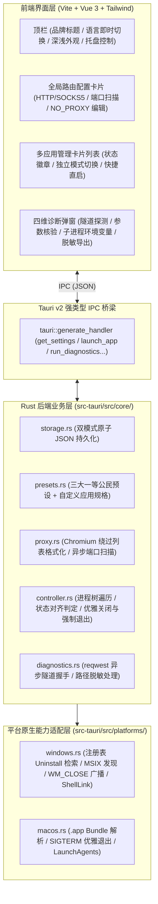

# Local-AI-Route 项目计划书

> [!IMPORTANT]
> 本计划书基于对 [oliver804/Local-Route-Launcher](https://github.com/oliver804/Local-Route-Launcher) 与 [DSDS-CMHL/EasyAntigravity](https://github.com/DSDS-CMHL/EasyAntigravity) 源码的完整拆解及架构设计决策编制。
> 现已完成向 **Rust + Tauri v2 + Vue 3 / Tailwind CSS** 现代原生方案的全面重构，彻底解决旧方案在打包体积（原 100MB+ 降至 15MB）、高分屏缩放撕裂、冷启动延迟与杀毒软件误报方面的结构性缺陷。

---

## 1. 项目定位与合并范围

**Local-AI-Route** 是一款轻量级、免管理员权限、免全局 TUN / 免改系统代理的**桌面 AI 应用进程级路由启动与诊断工具**。

### 1.1 上游能力取舍对照

| 能力维度 | Local-Route-Launcher (v1.3.0) | EasyAntigravity (v4.0.4 Lite) | Local-AI-Route 合并方案 (Tauri v2) |
| :--- | :--- | :--- | :--- |
| **目标应用** | ChatGPT 桌面端（及商店 Codex） | Antigravity 桌面版 (Hub) + Antigravity IDE | **三大内置预设（ChatGPT APP、Antigravity 桌面版、Antigravity IDE）+ 支持一键添加任意 Chromium/Electron 自定义应用** |
| **并发管理** | 单目标管理 | 同一时间仅激活单一目标会话 | **多应用并列卡片，支持同时运行、独立启停与独立“走代理 / 直连”开关** |
| **代理协议与端口** | 仅无认证 HTTP（Host + Port） | 仅本机 HTTP 端口 + 常用端口快捷检测 | **全局共享代理配置，支持 `HTTP` 与 `SOCKS5`、本地常见代理端口扫描填入、可编辑 `NO_PROXY` 绕过列表** |
| **连接诊断** | 隧道探测 + 启动参数校验 + 进程树 TCP 快照 | 仅基础端口检测与启动日志 | **四维精细化诊断：按应用定制目标域名探测 + 主进程参数校验 + Antigravity `language_server` 子进程环境变量校验 + 进程树 TCP 快照（脱敏导出）** |
| **日常启动体验** | 必须打开启动器或托盘点击启动 | 必须通过面板点击启动 | **系统托盘快速启停 + 开机静默驻留 + `--launch <id>` 命令行直启 + 一键生成带原应用图标的“带代理桌面快捷方式”** |
| **跨端稳定性** | Python Tkinter（容易卡死/误报） | Python CustomTkinter | **Rust + Tauri v2（纯 PE 机器码，毫秒级秒开，零误杀，零死锁）** |

---

## 2. 技术栈与跨平台分层架构

### 2.1 核心技术选型（Rust + Tauri v2 + Vue 3）

| 模块 | 选型库 / 框架 | 选型理由 |
| :--- | :--- | :--- |
| **应用容器与宿主** | `Tauri v2` | 基于系统内置 WebView2 / WebKit，安装包仅约 15MB，冷启动 <0.3s，原生支持 System Tray、Single Instance、Autostart |
| **前端交互界面** | `Vue 3` + `Tailwind CSS` + `Lucide Icons` | 现代响应式状态管理、像素级高分屏适配、平滑深浅色切换与中英双语即时切换 |
| **系统进程与监控** | `sysinfo` + `windows-rs` / `libc` | 原生跨平台安全枚举进程命令行、环境变量、子进程树与发送优雅关闭信号（`WM_CLOSE`），杜绝线程安全崩溃 |
| **代理连通性探测** | `reqwest[socks]` + `tokio` | 高性能异步并发测试 HTTP/SOCKS5 隧道可达性与超时控制 |
| **Windows 原生集成** | `winreg` + `mslnk` + `windows` | 读取注册表、MSIX 包名扫描解析、桌面 `.lnk` 快捷方式生成 |
| **配置存储** | `serde` + `serde_json` | 双模式原子 JSON 存储（绿色便携 `./data/` vs 系统 `%LOCALAPPDATA%`） |

### 2.2 架构分层图



---

## 3. 目录结构

```text
local_ai_route/
├── package.json                   # 前端依赖配置与构建脚本
├── vite.config.ts                 # Vite 打包配置 (整合 Tauri)
├── tailwind.config.js             # Tailwind CSS 主题配置 (支持暗黑模式)
├── index.html                     # 界面入口 HTML
├── assets/                        # 原始应用图标与资源
├── src/                           # 前端源码
│   ├── main.ts                    # Vue 启动入口
│   ├── App.vue                    # 主应用面板组件
│   ├── i18n.ts                    # 中英双语响应式字典
│   ├── types.ts                   # 对应 Rust 端的数据类型定义
│   └── styles.css                 # Tailwind 样式引入
├── src-tauri/                     # Rust 原生后端工程
│   ├── Cargo.toml                 # Rust 依赖声明
│   ├── tauri.conf.json            # Tauri v2 窗口、托盘与权限配置
│   ├── capabilities/              # 权限能力描述
│   ├── icons/                     # Windows / macOS 原生托盘与可执行文件图标
│   └── src/
│       ├── main.rs                # 独立启动入口
│       ├── lib.rs                 # Tauri 构建器、托盘与生命周期管理
│       ├── commands.rs            # 供前端调用的 IPC 命令实现
│       ├── core/                  # 核心路由与诊断逻辑
│       │   ├── models.rs          # 领域模型定义
│       │   ├── presets.rs         # 内置应用预设
│       │   ├── proxy.rs           # 代理规则与端口扫描
│       │   ├── storage.rs         # 双模式原子存储
│       │   ├── controller.rs      # 进程树管理与安全重启
│       │   └── diagnostics.rs     # 四维诊断引擎
│       └── platforms/             # 系统底层调用适配
│           ├── mod.rs
│           ├── windows.rs         # Windows 注册表、MSIX、.lnk 快捷方式
│           └── macos.rs           # macOS 适配
├── scripts/
│   └── build_windows.ps1          # 自动化构建独立 Windows x64 绿色便携发布包脚本
├── README.md                      # 中文说明文档
├── README.en.md                   # 英文说明文档
└── LICENSE                        # MIT 许可证
```

---

## 4. 关键特性与实现细节

### 4.1 全局代理与 Chromium 进程级注入
- **启动参数注入**：
  - `--proxy-server=<scheme>://<host>:<port>`
  - `--proxy-bypass-list=<formatted_list>`（自动追加 `<local>` 兼容 Electron 规则）
  - `--disable-quic`（阻断 UDP 绕过）
- **环境变量注入**：
  - `HTTP_PROXY`, `HTTPS_PROXY`, `ALL_PROXY`, `NO_PROXY`, `NODE_USE_ENV_PROXY=1`

### 4.2 四维精细化连接诊断
1. **代理隧道探测 (`Tunnel Probe`)**：通过当前代理对目标端点（ChatGPT / Google）发送轻量探测请求，区分连接被拒与成功握手。
2. **主进程启动参数核验 (`CLI Args Check`)**：读取正在运行的主进程命令行，校验 `--proxy-server` 是否匹配当前配置。
3. **关键子进程环境变量核验 (`Subprocess Env Check`)**：针对 Antigravity 专项核查 `language_server` 子进程的环境变量。
4. **进程树活跃 TCP 快照 (`PID-Tree TCP Snapshot`)**：仅监控目标应用进程树内指向代理端口的连接，并自动脱敏替换 `%USERPROFILE%`。

### 4.3 配置存储与便携模式
- 若可执行文件同级目录存在 `data/` 或 `portable.flag`，配置持久化于 `./data/settings.json`。
- 否则默认持久化于 `%LOCALAPPDATA%\Local-AI-Route\settings.json`。
- 写入均经过临时文件 + 原子替换，确保断电或意外退出时不发生配置损坏。

---

## 5. 验收标准与交付物

- **绿色便携构建包**：`Local-AI-Route-v0.2.0-windows-x64-portable.zip`（内含独立 `Local-AI-Route.exe` 与 `data/` 目录）。
- **零依赖运行**：解压即用，无需用户安装 Python、Node.js 或额外的 Visual C++ 运行库。
